# Customer Churn Prediction (MLOps)

[](https://github.com/sadiaparveen-git/customer-churn-prediction_mlops/actions/workflows/ci.yml)
[](https://hub.docker.com/r/sadiaparveen/customer-churn-mlops)


Telecom churn model (XGBoost, tuned for recall) with MLflow tracking, served by
FastAPI and Gradio from one Docker image, tested and published by GitHub
Actions, and deployed to AWS ECS.

## Links

- **Live demo:** https://ch-2be24e3703004356be1576050507f7de.ecs.eu-west-1.on.aws/ui
<!-- - **Hugging Face Spaces:** TODO -->
- **Docker:** `docker pull sadiaparveen/customer-churn-mlops:latest`

<!-- TODO: add screenshots, e.g.  and  -->

## Results

Held-out test set: 1,409 customers, 374 churners (26.5%). Decision threshold 0.469.

| Metric (churn class) | Value                                               |
| -------------------- | --------------------------------------------------- |
| Recall               | 0.837 (313 of 374 churners caught)                  |
| Precision            | 0.479 (313 of 654 customers flagged)                |
| F1                   | 0.609                                               |
| PR-AUC               | 0.642 (a random model scores 0.265, the churn rate) |
| ROC-AUC              | 0.835                                               |

Recall is the priority because a missed churner is lost revenue, while a false
alarm only costs a retention offer.

Source: recall, precision, F1 and ROC-AUC are in `model/model_info.json` (MLflow
run `e04cbcc2…`). PR-AUC is not logged to MLflow; it was computed from the
shipped model on the same reproduced test split.

## Data science decisions

**Business goal.**
Problem: a missed churner loses the customer; a false alarm costs one retention offer.
Solution: tune for churn-class recall of at least 0.80, then maximise precision.

**Class imbalance.**
Problem: only 26.5% of customers churn, so the model favours "stay".
Solution: XGBoost's class weight (`scale_pos_weight`), searched by Optuna between 1 and 2x the class ratio (chosen: 5.30). Churners then count more in training and the data itself is left unchanged.

**Decision threshold.**
Problem: the default 0.5 cut-off misses too many churners.
Solution: Optuna (seeded TPE sampler, 20 trials) searches the XGBoost parameters, the class weight and a threshold between 0.25 and 0.5 together. A trial scores its churn precision if its recall is at least 0.80, otherwise it is ranked below all trials that meet the floor. Among trials within 0.01 precision of the best, higher recall wins. Result: threshold 0.469.

**No data leakage.**
Problem: tuning on the test data would inflate the results.
Solution: scikit-learn's `train_test_split` makes one stratified 80/20 train/test split. Tuning splits the training part again (4,507 fit / 1,127 validation rows) and picks parameters and threshold on the validation rows only. The final model is refit on all 5,634 training rows, and the test set is used once, for the reported metrics.

**Metrics.**
Problem: accuracy hides failure; always predicting "no churn" scores 73.5%.
Solution: report churn-class recall, precision, F1, PR-AUC and ROC-AUC (scikit-learn). PR-AUC is not inflated by the many easy "stay" customers.

**Reading the score.**
Problem: with class weighting the score is not a probability, so "0.12" cannot be shown as a 12% chance.
Solution: `scripts/build_score_reference.py` scores the test customers once and saves four risk levels (with the share who really churned) and a percentile table. The API returns the level and the percentile with every prediction.

| Risk level | Score        | Test customers | Actually churned |
| ---------- | ------------ | -------------- | ---------------- |
| Low        | below 0.20   | 530            | 4%               |
| Moderate   | 0.20 to 0.47 | 225            | 17%              |
| High       | 0.47 to 0.85 | 412            | 36%              |
| Very high  | 0.85 and up  | 242            | 68%              |

"High" starts at the decision threshold, so the level always agrees with the yes/no decision.

**Same features in training and serving.**
Problem: one customer sent to the API must be encoded exactly as in training.
Solution: `fit_features` learns the encodings once and saves them as `feature_schema.json`; `transform_features` applies them in both training and serving. pytest checks that one row gives the same features and the same score as the same row in a batch.

## MLOps architecture

```mermaid
flowchart LR
    A["Telco CSV"] --> B["Validate<br/>Great Expectations"]
    B --> C["Features, Optuna tuning,<br/>XGBoost training"]
    C --> D[("MLflow runs")]
    D --> E["export_model.py<br/>model/ bundle"]
    E --> F["FastAPI + Gradio<br/>one container, port 8000"]
    F --> G["Docker image"]
    G --> H["GitHub Actions<br/>test, container smoke test, push"]
    H --> I["Docker Hub<br/>:latest and :sha"]
    I --> J["AWS ECS Express Mode<br/>Fargate + ALB, HTTPS"]
```



- **Pinned serving dependencies.** `requirements-serving.txt` pins exact
  versions; the CPU-only `xgboost-cpu` build is used on x86_64.
- **Small image.** `python:3.11-slim`, non-root user, no training tools or
  MLflow. 659 MB unpacked on x86_64 (219 MB compressed on Docker Hub).
- **Health endpoint.** `/health` backs both the Docker `HEALTHCHECK` and the
  load balancer check.
- **SHA tags.** Every push to `main` that passes the tests publishes
  `:latest` and `:<short commit sha>`, so any version can be redeployed. The
  demo runs a SHA tag.
- **Secrets.** Docker Hub credentials are GitHub Actions secrets, never in the
  repo.
- **Model bundle in git.** The 1.3 MB `model/` folder is committed, so
  deployment needs no MLflow or retraining.

The CI pipeline (`.github/workflows/ci.yml`) runs 103 tests, builds the image,
starts it and checks `/health`, `/model-info`, `/predict` and `/ui`, and only
then pushes to Docker Hub.

## Run it yourself

```bash
docker pull sadiaparveen/customer-churn-mlops:latest
docker run --rm -p 8000:8000 sadiaparveen/customer-churn-mlops:latest
```

- Web UI: http://127.0.0.1:8000/ui
- API docs: http://127.0.0.1:8000/docs

The image is built for `linux/amd64`. On Apple Silicon, Docker runs it under
emulation, or build your own with `docker build -f docker/Dockerfile -t churn-api .`.

### Local development

Needs Python 3.11 and the IBM Telco Customer Churn CSV saved as
`data/raw/Telcom-Customer-Churn.csv` (not in the repo). On macOS, run
`brew install libomp` once.

```bash
python3.11 -m venv .venv && source .venv/bin/activate
pip install -r requirements.txt

python scripts/run_pipeline.py            # validate, tune, train, evaluate, log to MLflow
python scripts/export_model.py            # write the model/ bundle from the latest run
python scripts/build_score_reference.py   # add risk levels and percentiles to the bundle
uvicorn app.main:app --reload             # UI at /ui, docs at /docs on port 8000
pytest tests                              # 103 tests
```

View runs with `MLFLOW_ALLOW_FILE_STORE=true mlflow ui --backend-store-uri ./mlruns`.

## Project structure

```
.
├── app/
│   ├── main.py                   # FastAPI service: /predict, /health, /model-info; mounts the UI at /ui
│   ├── schemas.py                # Pydantic request/response models and input validation
│   └── app.py                    # Gradio web page (calls the API over HTTP)
├── src/
│   ├── data/
│   │   ├── load_data.py          # Read the raw CSV
│   │   └── preprocess.py         # Clean the data, turn Churn into 0/1
│   ├── features/
│   │   └── build_features.py     # Fit/transform encoding, saved as feature_schema.json
│   ├── models/
│   │   ├── tune.py               # Optuna search: parameters, class weight, threshold
│   │   ├── train.py              # Train XGBoost, log to MLflow
│   │   └── evaluate.py           # Test-set metrics
│   ├── serving/
│   │   ├── inference.py          # ChurnPredictor: scores one customer
│   │   └── score_reference.py    # Risk level and percentile lookup
│   └── utils/
│       └── validate_data.py      # 23 Great Expectations checks
├── scripts/
│   ├── run_pipeline.py           # Runs the whole workflow (start here)
│   ├── export_model.py           # Exports an MLflow run as the model/ bundle
│   └── build_score_reference.py  # Builds risk levels and percentiles for the bundle
├── model/                        # Committed serving bundle (~1.3 MB)
│   ├── model.ubj                 # XGBoost model
│   ├── feature_schema.json       # Encodings and exact column order
│   ├── model_info.json           # Threshold, run ID, test metrics
│   └── score_reference.json      # Risk levels and sorted test scores
├── tests/                        # 103 pytest tests (synthetic data, no CSV needed)
├── docker/Dockerfile             # Serving image (API + web page)
├── notebooks/EDA.ipynb           # Exploration and model comparison
├── .github/workflows/ci.yml      # Test, container smoke test, push to Docker Hub
├── data/                         # raw/ (put the CSV here), processed/ (generated); not in git
├── artifacts/, mlruns/           # Generated by the pipeline; not in git
├── configs/                      # Reserved for configuration files
├── requirements.txt              # Pinned training and development dependencies
└── requirements-serving.txt      # Pinned dependencies for the Docker image
```

The data files, `artifacts/` and `mlruns/` are created when you run the
pipeline and are listed in `.gitignore`. The small `model/` bundle is the
exception: it is committed, so the service can be built and deployed without
retraining.

## License

[MIT](LICENSE)
